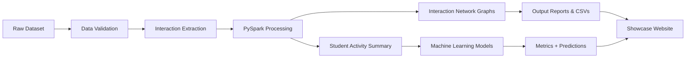
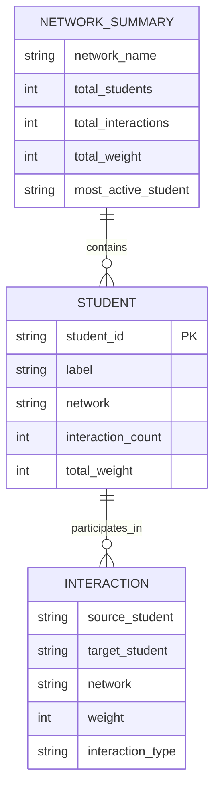
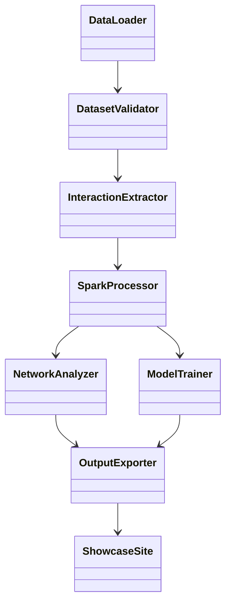
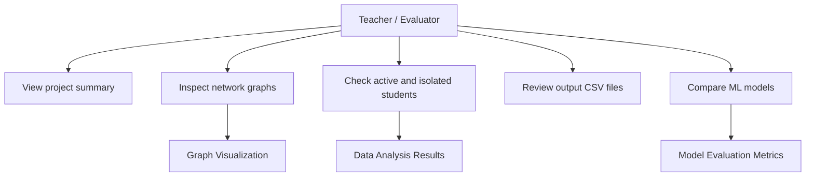
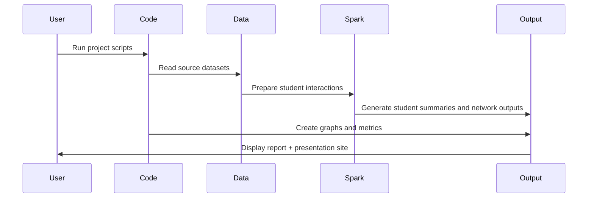

# INT315 Cluster Computing CA2

<div align="center">
  
  
  
  
</div>

<p align="center">
  <strong>Online Learning Platform Interaction Analysis</strong><br>
  A graph-based study of student interaction patterns, active users, isolated students, and predictive modeling.
</p>

---

## Project Overview

This project analyzes interaction data from an online learning platform and models the relationships between students as a graph network. Each student is represented as a node, and each interaction is treated as an edge. The project combines:

- Spark-based processing for large-scale data transformation
- Network analysis for student activity and isolated nodes
- Visualization of interaction networks across groups
- Machine learning models to predict interaction strength
- A clean local presentation page for project demonstration

---

## Problem Statement

The goal is to understand:

- how students interact with each other inside the platform
- which students are the most active
- which students are isolated or disconnected
- how interaction strength varies across learning groups
- how well machine learning can predict total interaction weight

---

## System Architecture



---

## ER Diagram



---

## UML Class / Workflow View



---

## Use Case View



---

## Data Flow



---

## Folder Structure

```text
INT315CA2PROJECT/
├── code/
│   ├── check_dataset.py
│   ├── extract_interactions.py
│   ├── spark_processing.py
│   ├── linear_regression.py
│   └── decision_tree.py
├── data/
│   ├── CD_RAW.net
│   ├── ICS_RAW.net
│   └── PS_RAW.net
├── output/
│   ├── interactions.csv
│   ├── students.csv
│   ├── student_activity.csv
│   ├── network_summary/
│   └── ... generated result files
├── showcase_site/
│   ├── index.html
│   ├── styles.css
│   ├── script.js
│   └── assets/
├── README.md
└── .git/
```

---

## Project Pipeline

### 1. Dataset Validation
The project first checks whether the input files are valid and consistent before processing.

### 2. Interaction Extraction
Raw connection data is transformed into a clean interaction dataset containing source, target, and interaction information.

### 3. Spark Processing
PySpark is used to aggregate data, compute student activity, and identify the most connected and isolated students.

### 4. Graph Analysis
Students are treated as nodes and interactions as links. The project produces network visualizations for ICS, CD, and PS.

### 5. Prediction Modeling
The processed activity data is used to train:

- Linear Regression
- Decision Tree Regressor

These models predict `total_weight` using interaction features and network labels.

### 6. Presentation Layer
The generated figures and outputs are displayed through a local static showcase site.

---

## Key Results

### Network Summary
- ICS had the largest interaction volume
- PS recorded the highest overall total weight
- Most active students were identified using interaction count and total weight
- Isolated students were detected and reported separately

### Model Performance

- Linear Regression: MAE = 5.1483, RMSE = 7.6487, R² = 0.8930
- Decision Tree: MAE = 5.0199, RMSE = 7.8983, R² = 0.8859

The Linear Regression model performed slightly better overall on this dataset.

---

## How to Run

```bash
python code/check_dataset.py
python code/extract_interactions.py
python code/spark_processing.py
python code/linear_regression.py
python code/decision_tree.py
```

To view the presentation site locally:

```bash
cd showcase_site
python -m http.server 8000
```

Then open:

```text
http://localhost:8000
```

---

## Technologies Used

- Python
- PySpark
- Pandas
- NetworkX
- Matplotlib
- scikit-learn
- HTML / CSS / JavaScript

---

## Dataset

- Dataset name: Anonymous networks of student interactions
- Source: KU Research Profiles
- URL: https://researchprofiles.ku.dk/en/datasets/anonyme-netv%C3%A6rk-af-studerendes-interaktioner/

This project uses the anonymized student interaction network dataset from the source above to analyze student communication patterns, network structure, activity levels, and predictive modeling of interaction strength.

---

## Final Notes

This project combines data engineering, graph analytics, and machine learning in a beginner-friendly structure. It is designed to demonstrate how raw interaction data can be transformed into meaningful insights through connected network analysis and predictive modeling.

---

<p align="center">
  <strong>INT315 • Cluster Computing CA2</strong>
</p>
